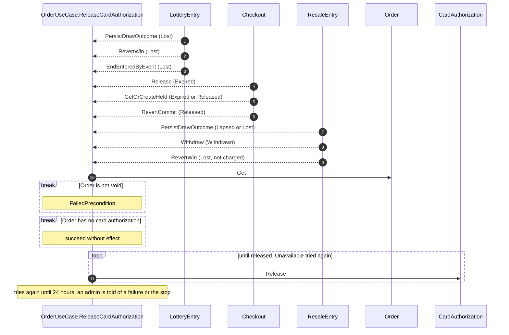

# components/usecase/order/release-card-authorization Specification

## Purpose
OrderUseCase.ReleaseCardAuthorization gives back, without charging, the card authorization of a Void Order: the Order of a lottery entry that lost, and of any other application that ended without a charge.

## Requirements

### Requirement: Every Void Order's card authorization is released

ReleaseCardAuthorization SHALL take an Order and run once for the Order of each entry that LotteryEntry.PersistDrawOutcome records Lost and each entry that LotteryEntry.RevertWin or LotteryEntry.EndEnteredByEvent makes Lost, and for the Order of each Checkout that Checkout.Release or Checkout.GetOrCreateHeld makes Expired and each that Checkout.GetOrCreateHeld or Checkout.RevertCommit makes Released, and for the Order of each ResaleEntry that ResaleEntry.PersistDrawOutcome makes Lapsed or Lost, ResaleEntry.Withdraw makes Withdrawn, or ResaleEntry.RevertWin makes Lost with the lost reason "card could not be charged" or "concert cancelled" (with "payment not completed before the show", OrderUseCase.Issue has released it already, and with "listing cancelled" it was charged and refunded). It SHALL read the Order with Order.Get and release its card authorization with CardAuthorization.Release. It SHALL fail with FailedPrecondition, releasing nothing, when the Order is not Void, and SHALL succeed without effect when the Order has no card authorization, as for a Checkout whose fan never authorized a card. When the release fails with Unavailable, it SHALL try again until 24 hours after it started; a failure of any other kind, such as FailedPrecondition for a card authorization that was charged, SHALL end it with that failure. A run that ends with a failure, or stops at its 24 hours, SHALL be reported to an admin, so no Void Order's card authorization is left held without notice.

#### Scenario: Entry of a cancelled concert released
- **WHEN** LotteryEntry.EndEnteredByEvent makes an entry Lost
- **THEN** its Order's card authorization is Released and nothing is charged

#### Scenario: Loser released
- **WHEN** a draw records an entry Lost
- **THEN** its Order's card authorization is Released and nothing is charged

#### Scenario: Win reverted
- **WHEN** OrderUseCase.Issue makes a Won entry Lost because its card authorization can no longer be charged
- **THEN** ReleaseCardAuthorization runs for its Order and the card authorization is Released

#### Scenario: Order not Void
- **WHEN** ReleaseCardAuthorization runs for an Order that is Pending
- **THEN** it fails with FailedPrecondition and nothing is released

#### Scenario: Payment provider unavailable
- **WHEN** CardAuthorization.Release fails with Unavailable and succeeds 10 minutes later
- **THEN** the card authorization is Released

#### Scenario: Payment provider unavailable for a day
- **WHEN** CardAuthorization.Release fails with Unavailable for 24 hours
- **THEN** ReleaseCardAuthorization stops, the card authorization stays as it is, and an admin is told

#### Scenario: Charged card authorization
- **WHEN** CardAuthorization.Release fails with FailedPrecondition
- **THEN** ReleaseCardAuthorization ends with FailedPrecondition, nothing changes, and an admin is told

#### Scenario: Hold expired
- **WHEN** a fan's hold expires and the Checkout's Order becomes Void
- **THEN** ReleaseCardAuthorization runs for that Order and the card authorization is Released

#### Scenario: Count changed after authorizing
- **WHEN** a fan authorized their card for 2 tickets and then started again for 3
- **THEN** ReleaseCardAuthorization runs for the 2-ticket Checkout's Order

#### Scenario: No card authorization
- **WHEN** ReleaseCardAuthorization runs for a Void Order that never had a card authorization
- **THEN** it succeeds, nothing is released and no admin is told

#### Scenario: Resale entry withdrawn
- **WHEN** a fan withdraws their Entered resale entry
- **THEN** ReleaseCardAuthorization runs for its Order and the card authorization is Released

#### Scenario: Win reverted for a cancelled concert
- **WHEN** OrderUseCase.Issue makes a Won entry Lost with the lost reason "concert cancelled" before charging it
- **THEN** ReleaseCardAuthorization runs for its Order and the card authorization is Released

#### Scenario: Win reverted after a refund
- **WHEN** OrderUseCase.Issue makes a Won entry Lost with the lost reason "listing cancelled"
- **THEN** ReleaseCardAuthorization does not run for its Order
