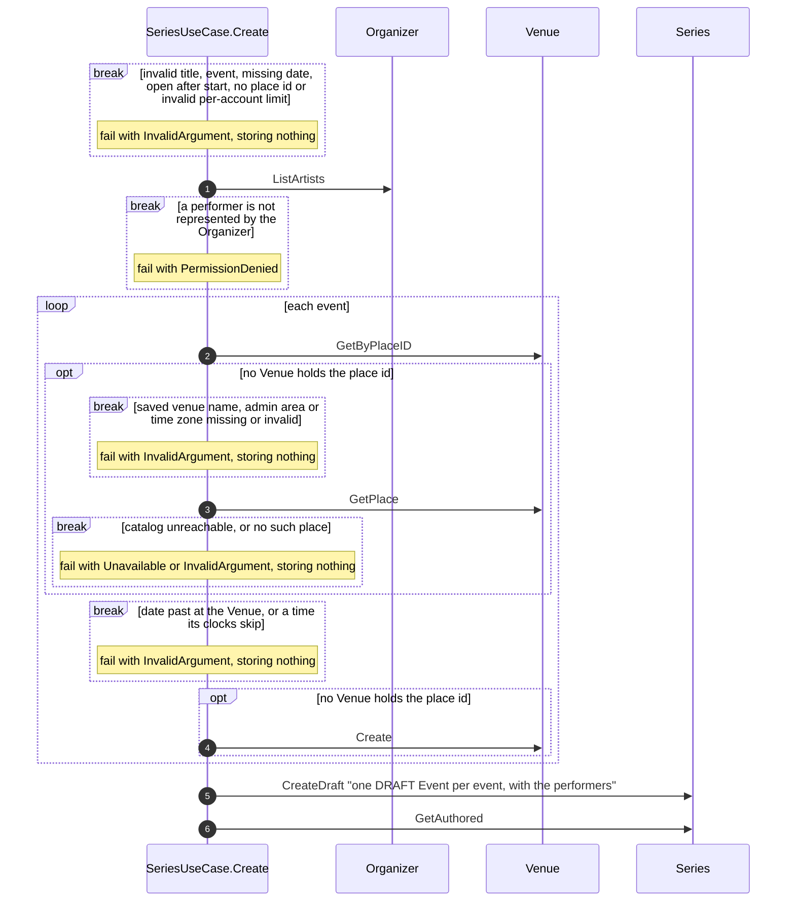

# Create

## Purpose

Create lets a member of an Organizer start a new first-party concert — a Series with one or more DRAFT Events and the Artists it represents as performers — that no fan can see and nobody is notified about until its Events are published.

## Requirements

### Requirement: Draft input is validated

Create SHALL fail with InvalidArgument, storing nothing, when the title is empty, when there is no event, when an event has no date, when an event's date is before the current date at its Venue (see Venue, "Current date at a venue"; for a new place, in the time zone the member saved), or when an event's open time is after its start time. An empty performer list is accepted in a draft; publishing requires at least one performer.

#### Scenario: No event
- **WHEN** a draft is created with no event
- **THEN** Create fails with InvalidArgument

#### Scenario: Date in the past
- **WHEN** an event's date is yesterday at its Venue
- **THEN** Create fails with InvalidArgument

#### Scenario: Today at a venue behind UTC
- **WHEN** a draft is created at 2026-11-11 07:00 UTC with an event dated 2026-11-10 at a Venue in America/Los_Angeles, where it is still 2026-11-10
- **THEN** the event's date is accepted

#### Scenario: Doors after start
- **WHEN** an event opens at 19:00 and starts at 18:00
- **THEN** Create fails with InvalidArgument

### Requirement: Only represented artists

Create SHALL fail with PermissionDenied, without saying which Artist, when any performer is not among the Artists the caller's Organizer represents (Organizer.ListArtists).

#### Scenario: Unrepresented artist
- **WHEN** the draft names an Artist the Organizer does not represent
- **THEN** Create fails with PermissionDenied and stores nothing

### Requirement: Draft stored as DRAFT

Create SHALL store the Series, owned by the caller's Organizer, with one DRAFT Event per event — a multi-showtime day being several Events — each with the performers (Series.CreateDraft), and SHALL return the Series with its Events and performers (Series.GetAuthored). Nothing SHALL be announced.

#### Scenario: Draft for a represented artist
- **WHEN** a member creates a draft with one event naming a represented Artist
- **THEN** a Series owned by the Organizer with one DRAFT Event is returned and no fan list or notification shows it

#### Scenario: Two showtimes
- **WHEN** the draft has 13:00 and 18:00 events on one date at one venue
- **THEN** the Series has two DRAFT Events

### Requirement: Each event's venue is a picked place

Every event SHALL give the place id of a place the member picked from the map catalog; an event without one SHALL fail Create with InvalidArgument, storing nothing. For each event, Create SHALL use the Venue holding the place id when one is held (Venue.GetByPlaceID), and SHALL then ignore any venue name, admin area and time zone the event gives. Otherwise the event SHALL give the venue name, admin area and time zone the member saved, and Create SHALL read the place from the map catalog (Venue.GetPlace) and create a Venue (Venue.Create) with the place id, that venue name, admin area and time zone, and the place's coordinates with the time they were read. The place's name, suggested admin area and time zone from the map catalog SHALL NOT be stored unless the member saved them. An event for a new place without a venue name, without an admin area, with an admin area that is not the code of a first-level Area, without a time zone, or with a time zone a Venue in that Area may not have (see Venue, "Time zone of a venue") SHALL fail Create with InvalidArgument, storing nothing. When the catalog cannot be reached it SHALL fail with Unavailable, storing nothing; when the catalog has no such place it SHALL fail with InvalidArgument, storing nothing.

#### Scenario: Known place id
- **WHEN** an event gives a place id that a Venue holds
- **THEN** that Venue is used and the catalog is not read

#### Scenario: New place
- **WHEN** an event gives the place id of Zepp Haneda, which no Venue holds, with the venue name "Zepp Haneda", the admin area JP-13 and the time zone Asia/Tokyo the member saved
- **THEN** a Venue named "Zepp Haneda" is created with that place id, its coordinates and their fetch time, JP-13 and Asia/Tokyo

#### Scenario: Member's values differ from the place's
- **WHEN** the map catalog names the place "Gocheok Sky Dome" and suggests KR-11, and the member saved the name "高尺スカイドーム", the admin area KR-11 and the time zone Asia/Seoul
- **THEN** the Venue is created named "高尺スカイドーム" in KR-11 with the time zone Asia/Seoul

#### Scenario: Same name in two cities
- **WHEN** one event picks CLUB QUATTRO in Shibuya and another picks CLUB QUATTRO in Umeda
- **THEN** the two events have two different Venues, in JP-13 and JP-27

#### Scenario: Venue typed but not picked
- **WHEN** an event gives a venue name but no place id
- **THEN** Create fails with InvalidArgument and nothing is stored

#### Scenario: New place without a saved area or time zone
- **WHEN** an event gives a place id that no Venue holds and no admin area or no time zone
- **THEN** Create fails with InvalidArgument and nothing is stored

#### Scenario: Time zone of another country
- **WHEN** an event for a new place gives the admin area JP-13 and the time zone Asia/Seoul
- **THEN** Create fails with InvalidArgument and nothing is stored

#### Scenario: Catalog down for a new place
- **WHEN** no Venue holds the given place id and the catalog cannot be reached
- **THEN** Create fails with Unavailable and nothing is stored

### Requirement: Each event's per-account limit

Create SHALL take an optional per-account limit for each event and store it on the Event, with 4 when none is given. It SHALL fail with InvalidArgument, storing nothing, when a given limit breaks the Event's per-account limit rule.

#### Scenario: No limit given
- **WHEN** a draft is created with an event without a per-account limit
- **THEN** the Event's per-account limit is 4

#### Scenario: Limit of 2
- **WHEN** a draft is created with an event whose per-account limit is 2
- **THEN** the Event's per-account limit is 2

#### Scenario: Limit above one admission code
- **WHEN** an event's per-account limit is 11
- **THEN** Create fails with InvalidArgument and nothing is stored

### Requirement: Event times are wall-clock times at the venue

Create SHALL take each event's open and start times as times of day at its Venue, in the Venue's time zone (for a new place, the time zone the member saved), and store them as given. An open or start time that does not exist on the event's date in that time zone, because a daylight saving change skips it, SHALL fail Create with InvalidArgument, storing nothing.

#### Scenario: Show abroad
- **WHEN** an event at a Venue in Asia/Seoul starts at 18:30
- **THEN** the DRAFT Event starts at 18:30 at its Venue

#### Scenario: Time skipped by daylight saving
- **WHEN** an event at a Venue in America/New_York on 2027-03-14 starts at 02:30
- **THEN** Create fails with InvalidArgument and nothing is stored
