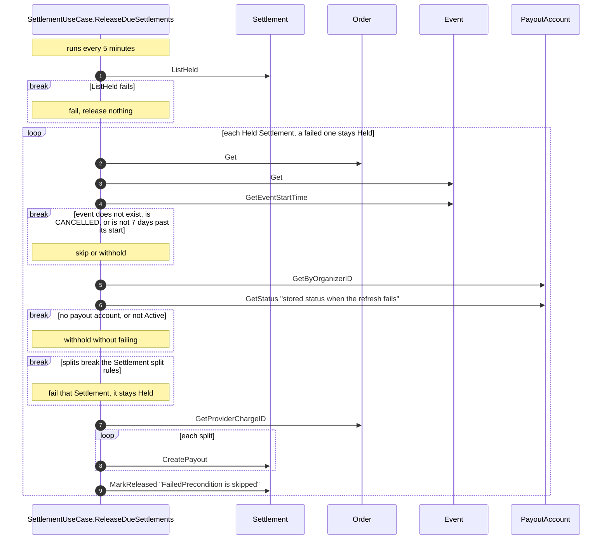

# SettlementUseCase.ReleaseDueSettlements

## Purpose

SettlementUseCase.ReleaseDueSettlements pays out every Held Settlement whose event is not CANCELLED and started more than 7 days ago and whose Organizer can receive payouts, then marks it Released.

## Requirements

### Requirement: Payout waits for the Organizer's payout account

ReleaseDueSettlements SHALL withhold the Settlement, without failing it, when the Organizer has no payout account, found with PayoutAccount.GetByOrganizerID, or when the account is not Active. It SHALL refresh the account's status with PayoutAccount.GetStatus before deciding, and use the stored status when the refresh fails.

#### Scenario: No payout account

- **WHEN** the Organizer has no payout account
- **THEN** the Settlement stays Held and is tried again on the next run

#### Scenario: Onboarding not complete

- **WHEN** the Organizer's payout account is Pending or Restricted
- **THEN** the Settlement stays Held

### Requirement: Pay out and mark Released

For an eligible Settlement with an Active payout account, ReleaseDueSettlements SHALL fail that Settlement, leaving it Held, when its splits break the Settlement split rules against the Order's amount. Otherwise it SHALL resolve the Order's charge with Order.GetProviderChargeID, pay each split to the Organizer's payout account with Settlement.CreatePayout in the Order's currency, and record the release with Settlement.MarkReleased. When Settlement.MarkReleased fails with FailedPrecondition because the Settlement is no longer Held, the Settlement is skipped without error.

#### Scenario: Settlement released

- **WHEN** a Held Settlement's event started 8 days ago and the Organizer's payout account is Active
- **THEN** its split is paid to the Organizer's payout account and it is Released

#### Scenario: Invalid splits

- **WHEN** a due Settlement has no split
- **THEN** nothing is paid and it stays Held

#### Scenario: Released concurrently

- **WHEN** Settlement.MarkReleased fails with FailedPrecondition
- **THEN** the Settlement is skipped and no error is raised

### Requirement: One failure does not block the others

A Settlement whose release fails SHALL NOT stop the others and stays Held for the next run. When Settlement.ListHeld fails, ReleaseDueSettlements SHALL fail with that error and release nothing.

#### Scenario: One payout fails

- **WHEN** paying one Settlement fails with Unavailable
- **THEN** the other due Settlements are still released and the failed one is tried again 5 minutes later

### Requirement: Release 7 days after the event's current start

ReleaseDueSettlements SHALL run every 5 minutes over the Settlements from Settlement.ListHeld. For each, it SHALL read the Order with Order.Get, the event's current publish state with Event.Get and the event's current start time with Event.GetEventStartTime, and SHALL withhold the Settlement, without failing it, unless it is eligible for release with a dispute buffer of 7 days. Both are read for each Settlement on every run, before any of its splits is paid, so a start time that is filled in after the purchase and a cancellation made after the purchase apply from the next such read. The Settlement of a CANCELLED Event is withheld on every run and stays Held. A cancellation stored after a run has read the event does not stop that run's payout of the Settlement, which becomes Released like any other. When a run has paid a split but cannot record the release, and the event is then CANCELLED, the Settlement stays Held with the payout unrecorded, and no later run records it. A Settlement whose event does not exist is skipped.

#### Scenario: Before the event plus 7 days

- **WHEN** the event started 3 days ago
- **THEN** the Settlement stays Held

#### Scenario: Event start unknown

- **WHEN** the event has no start time
- **THEN** the Settlement stays Held

#### Scenario: Start time filled in after the purchase

- **WHEN** the event had no start time when the Order was paid and its start time is later set to 8 days ago
- **THEN** on the next run the Settlement is eligible for release

#### Scenario: Cancelled event past the buffer

- **WHEN** a Held Settlement's event is CANCELLED, it started 8 days ago and the Organizer's payout account is Active
- **THEN** nothing is paid, no error is raised for the Settlement and it stays Held

#### Scenario: Cancelled after the run read the event

- **WHEN** a due Settlement's event is read as PUBLISHED and is cancelled before the split is paid
- **THEN** that run pays the split and the Settlement is Released

#### Scenario: Cancelled before a failed release is recorded

- **WHEN** a run paid a Settlement's split, Settlement.MarkReleased failed with Unavailable, and the event is cancelled before the next run
- **THEN** the next run pays nothing, does not call Settlement.MarkReleased and the Settlement stays Held
