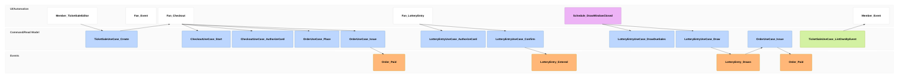

# stories/attribute-a-purchase-to-a-referral-link Specification

## Purpose
A fan opens an event link that carries a referral code, signs up if needed and buys tickets or enters the lottery within 7 days, and the Organizer sees the paid purchase counted under that code on the event's Sales tab.

## Requirements

### Requirement: A purchase counts for the link the fan came from

After an Organizer creates a FirstCome TicketSale for a published event of a PUBLIC Series with TicketSaleUseCase.Create, a fan who opens `/events/<id>?ref=<code>` for an event of that Series SHALL be able to sign up from the Event page and buy with CheckoutUseCase.Start, CheckoutUseCase.AuthorizeCard and OrderUseCase.Place within 7 days, and the Order SHALL then be counted under that code by TicketSaleUseCase.ListOwnByEvent for the event once it is Paid. The code is fixed when the Order is created: a hold the fan already has, resumed by CheckoutUseCase.Start for the same TicketStock and ticket count, keeps the code it was created with, even after the fan opened another member's link. A lottery entry authorized the same way SHALL be counted under its code once it won and its Order became Paid.

#### Scenario: Guest from a member's link buys after signing up
- **WHEN** a guest opens `/events/<id>?ref=member-a`, signs up from the Event page and buys 2 tickets of 3000 yen
- **THEN** the Organizer's Sales tab for the event lists member-a with 1件 2枚 6,000円

#### Scenario: Last link wins
- **WHEN** a fan opens a link with `ref=member-a`, then a link with `ref=member-b` for the same Series, and buys
- **THEN** the purchase is counted under member-b only

#### Scenario: Hold already in progress keeps its link
- **WHEN** a fan from a link with `ref=member-a` holds 2 tickets, opens a link with `ref=member-b` for the same Series, and continues the same 2 tickets of the same TicketStock before the hold expires
- **THEN** the purchase is counted under member-a only

#### Scenario: Another tour is not attributed
- **WHEN** a fan opens a link with `ref=member-a` for one Series and buys tickets for an event of another Series
- **THEN** the purchase is counted as 直接（コードなし）

#### Scenario: Link older than 7 days
- **WHEN** a fan opens a link with `ref=member-a` and buys 8 days later
- **THEN** the purchase is counted as 直接（コードなし）

#### Scenario: Abandoned checkout is not counted
- **WHEN** a fan from a link with `ref=member-a` holds tickets and lets the hold expire
- **THEN** nothing is counted under member-a
