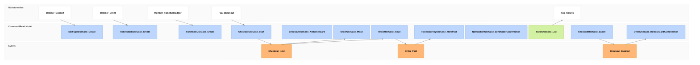

# stories/buy-tickets-first-come Specification

## Purpose
A fan buys tickets for an Organizer's event first come, first served: they hold tickets for 15 minutes, pay by card, and receive account-bound covered tickets with a confirmation email, while no fan is ever charged for tickets they do not receive.

## Requirements

### Requirement: Fan buys tickets

After an Organizer adds a SeatType to a Series with SeatTypeUseCase.Create, stocks it for a published event with TicketStockUseCase.Create and creates a FirstCome TicketSale naming the event with TicketSaleUseCase.Create, a signed-in fan SHALL be able to:
1. hold tickets of that TicketStock with CheckoutUseCase.Start;
2. authorize their card with CheckoutUseCase.AuthorizeCard, giving their full name and phone number, and complete card authentication;
3. place the order with OrderUseCase.Place.

Their Tickets SHALL then be in TicketUseCase.List, and a confirmation email SHALL arrive within 5 minutes.

#### Scenario: Two tickets bought

- **WHEN** a fan buys 2 tickets of a SeatType priced 3000 yen from a TicketStock of 150
- **THEN** they are charged 6000 yen, hold 2 Issued Tickets of that SeatType for the event, their ticket journey for the event is Paid, and they receive one confirmation email

### Requirement: Never oversold, nobody charged for tickets they do not get

A TicketStock SHALL never sell more tickets than its quantity, counting every sale of its event. A fan who does not get tickets SHALL NOT be charged.

#### Scenario: Last ticket, two fans

- **WHEN** one ticket remains and two fans start a checkout for it at the same moment
- **THEN** one fan holds it and buys it, and the other is told it is sold out for now and is not charged

#### Scenario: Presale winners leave the rest

- **WHEN** a TicketStock of 150 had 120 tickets won in a lottery presale and its event's first-come general sale opens
- **THEN** the general sale sells at most 30 tickets of it

#### Scenario: Hold ran out

- **WHEN** a fan places the order 1 minute after their hold expired
- **THEN** the purchase is refused, the fan is not charged and their card authorization is released within 2 minutes

### Requirement: Retries never double

Repeating any step of the checkout, whether by a double tap, a retry, a reload or a second open tab, SHALL hold, charge and issue at most once.

#### Scenario: Double tap everywhere

- **WHEN** a fan taps continue twice and place order twice
- **THEN** they hold their tickets once, are charged once and receive one Order

### Requirement: Walking away gives the tickets back

A checkout abandoned before placing the order SHALL return its tickets to the TicketStock within 1 minute after its hold expires, and SHALL release any card authorization within 2 minutes after its hold expires.

#### Scenario: Fan closes the tab

- **WHEN** a fan holds 2 tickets at 18:00, authorizes their card and leaves
- **THEN** by 18:16 the 2 tickets are on sale again and by 18:17 the card authorization is released
