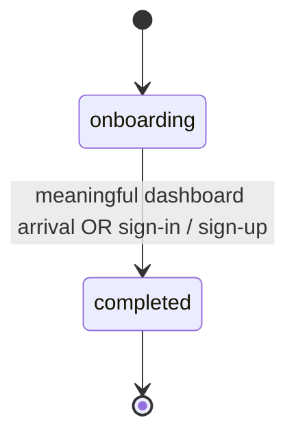

# Complete onboarding

## Purpose

Guides a new user through the onboarding sequence from landing to an irreversible completed state, tracking concert-search progress, presenting a final non-blocking analytics notice, and routing the app based on completion status.

## Requirements

### Requirement: Onboarding is one latched state

The fan web app SHALL model onboarding as a single persisted yes/no state, not an ordered step machine. A brand-new visitor SHALL start in `onboarding`, the state SHALL persist on the device across sessions (an absent value means `onboarding`), and it SHALL move exactly once, irreversibly, to `completed`, except via an explicit fresh-onboarding reset. There SHALL be no onboarding steps and no forced navigation: every route is reachable at any time (soft gate), and a guest with no follows is guided by an in-page empty-state CTA, not a redirect.

| State        | Description                                   |
|--------------|-----------------------------------------------|
| `onboarding` | First-run experience (default for a new user) |
| `completed`  | Onboarding finished (terminal; one-way)       |

#### Scenario: Brand-new user defaults to onboarding

- **WHEN** a user opens the app for the first time on a device with no stored onboarding state
- **THEN** the fan SHALL be in onboarding

#### Scenario: Completion latches on first meaningful dashboard arrival

- **WHEN** a fan in onboarding reaches the dashboard
- **AND** the timetable is real (a home area is set and the concert data has loaded)
- **AND** the fan follows at least one artist
- **THEN** onboarding SHALL become completed
- **AND** the latch SHALL be evaluated after the light-celebration decision (so that decision still sees the fan in onboarding), honoring the deferral while the home area is not yet chosen

#### Scenario: Completion latches after choosing the home area on arrival

- **WHEN** a fan in onboarding who follows at least one artist reaches the dashboard without a home area
- **AND** the fan chooses a home area in the home-area sheet
- **AND** the timetable then loads, including when it loads from concert data already fetched earlier in the same session
- **THEN** onboarding SHALL become completed exactly once

#### Scenario: Latch is independent of whether the celebration is shown

- **WHEN** a fan in onboarding reaches a meaningful first dashboard (home area set, data loaded, at least one followed artist)
- **AND** the light celebration is suppressed (it was already shown in an earlier session, or the timetable holds no concert)
- **THEN** onboarding SHALL still become completed
- **AND** the latch SHALL NOT be gated on the celebration overlay actually rendering

#### Scenario: No latch for a zero-follow dashboard arrival

- **WHEN** a fan in onboarding with zero followed artists lands on the dashboard (e.g. via deep link, served the empty-state CTA)
- **THEN** onboarding SHALL NOT become completed
- **AND** the fan SHALL stay in onboarding so the Discovery progress row and the page-help auto-open still apply until the fan follows an artist or signs in

#### Scenario: Completion latches on sign-in or sign-up

- **WHEN** a user completes a successful sign-up or sign-in through the auth callback
- **THEN** onboarding SHALL become completed
- **AND** completing it again when it is already completed SHALL change nothing

#### Scenario: Completion is one-way

- **WHEN** onboarding is already completed
- **AND** the user revisits the dashboard or any onboarding-relevant surface
- **THEN** onboarding SHALL stay completed
