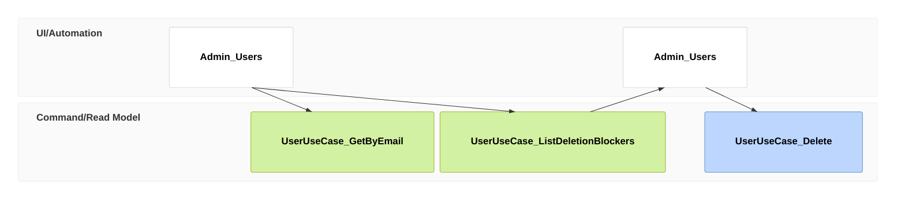

# stories/delete-a-fan-account Specification

## Purpose
An admin removes a fan's account at the fan's request: the admin finds it by the email address the request came from, checks nothing is in progress, and deletes it.

## Requirements

### Requirement: An admin deletes a fan's account by email

An admin SHALL be able to find a fan's account on the admin console's Users screen by its email address and delete it when it has no deletion blocker. Afterwards the fan SHALL no longer be able to sign in with that account, and the fan's orders and tickets SHALL remain as records.

#### Scenario: Request by email

- **WHEN** a fan asks by email to have their account removed and the admin finds it by that address and deletes it
- **THEN** the fan can no longer sign in to the account and its order and ticket records remain

#### Scenario: Fan with a ticket for an upcoming concert

- **WHEN** the admin finds a fan holding a ticket for a concert next week
- **THEN** the Users screen shows the ticket as a blocker and offers no Delete control
