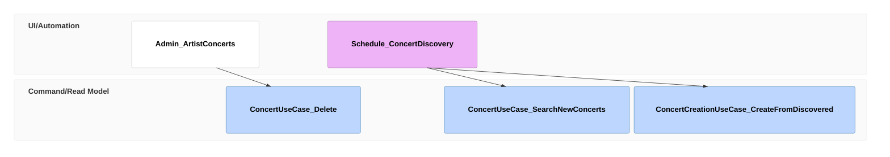

# Delete a wrong concert

## Purpose

An admin removes a wrong Concert from the catalog for good: the next discovery run does not bring the same slot back.

## Requirements

### Requirement: A deleted slot stays deleted

After ConcertUseCase.Delete removes a Concert, its Venue, date and start time SHALL stay suppressed for discovery: ConcertCreationUseCase.CreateFromDiscovered SHALL neither publish nor stage a concert at that slot. No usecase removes the suppression. An Organizer's publish at that slot SHALL succeed, since an Organizer publishes its own performance.

#### Scenario: Discovery finds it again
- **WHEN** an admin deletes a Concert and a later search finds the same slot for another Artist
- **THEN** no Concert and no ConcertCandidate exists for that slot

#### Scenario: Organizer publishes into the slot
- **WHEN** an Organizer publishes a draft with a performance at the deleted slot
- **THEN** the publish succeeds and the Event is PUBLISHED
