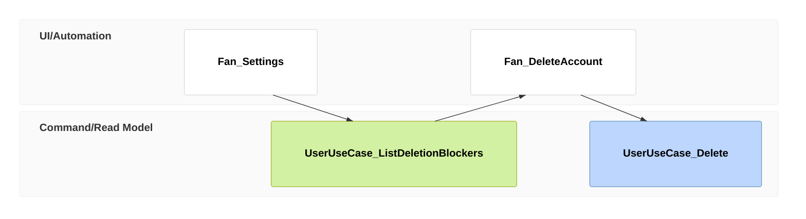

# stories/delete-my-account Specification

## Purpose
A signed-in fan leaves Liverty Music: once nothing they bought or entered is still in progress, they delete their account from Settings after signing in again, and can no longer sign in with it.

## Requirements

### Requirement: A fan deletes their own account

A signed-in fan with no deletion blocker SHALL be able to open the withdrawal screen from Settings, confirm, sign in again with a passkey and have their account deleted. Afterwards the fan SHALL be signed out, the passkey SHALL no longer sign in to any account, and their orders and tickets SHALL remain as records.

#### Scenario: Fan whose concerts are over

- **WHEN** a fan whose only ticket was for a concert last month deletes their account from Settings
- **THEN** the fan is signed out, signing in with the same passkey no longer reaches the account, and the order and ticket records remain

#### Scenario: Signing up again

- **WHEN** the deleted fan signs up again with the same email address
- **THEN** a new account is created with no follows, no tickets and no identity check (本人確認) result

### Requirement: Deletion waits for what is in progress

A fan with a ticket for an upcoming concert, a listed resale, a lottery entry awaiting its draw or a purchase being paid SHALL see it on the withdrawal screen and SHALL NOT be able to delete their account until it is finished.

#### Scenario: Ticket for next week

- **WHEN** a fan holding a ticket for a concert next week opens the withdrawal screen
- **THEN** the screen shows the ticket as a blocker and offers no way to delete the account

#### Scenario: After the concert

- **WHEN** the same fan opens the withdrawal screen the day after the concert
- **THEN** the screen offers to delete the account

### Requirement: A started deletion completes

Once a fan's deletion has started, the platform SHALL carry it on without the fan acting again. From the moment the account is removed, the fan's sign-in identity SHALL NOT get a new account, and once the deletion has completed, signing up with the same email address creates a new account. When it cannot complete, because something new blocks it, a failure cannot be retried or it still fails after 24 hours, an admin SHALL be told.

#### Scenario: Failure halfway

- **WHEN** a fan's deletion removed their account and removing their sign-in identity failed with a passing fault
- **THEN** once the fault has passed the identity is removed, and signing up again with the same email address creates a new account with no follows, no tickets and no identity check (本人確認) result

#### Scenario: Signing in before the identity is removed

- **WHEN** the fan signs in again after their account was removed and before their sign-in identity was
- **THEN** no account is created

#### Scenario: Deletion that cannot complete

- **WHEN** a fan's deletion removed their account and removing their sign-in identity still fails after 24 hours
- **THEN** an admin is told
