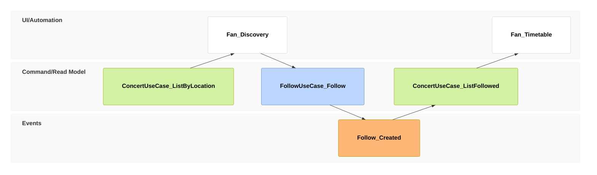

# stories/find-concerts-nearby Specification

## Purpose
A signed-in fan who wants to go to a live show soon finds the concerts near their area within a chosen period, including concerts of artists they do not follow yet, and follows an artist from one of those concerts so that its concerts reach their timetable. A guest is not offered the Concerts view: following artists from the bubbles comes first, and the view's follow and ticket actions need an account.

## Requirements

### Requirement: The concerts near the fan's area are listed for a period

From Discovery a signed-in fan SHALL reach, in one tap on the swap tile, the concerts that ConcertUseCase.ListByLocation returns for the fan's home area (or an area chosen for the visit) and the chosen period: concerts in the area as HOME, concerts in another area within 200 km as NEAR, whether or not the fan follows their artists. Concerts farther away SHALL NOT be listed. A guest SHALL NOT be offered the Concerts view: following artists comes first, and the view's follow and ticket actions need an account.

#### Scenario: A weekend near home
- **WHEN** a signed-in fan whose home area is Fukuoka opens Discovery, taps the swap tile and picks 今週末
- **THEN** this weekend's concerts in Fukuoka are listed under HOME and those in Kumamoto under NEAR, including artists the fan does not follow
- **AND** a concert in Tokyo the same weekend is not listed

#### Scenario: No home area yet
- **WHEN** a signed-in fan whose account has no home area opens the Concerts view
- **THEN** the fan is asked to choose an area before any concert is listed

#### Scenario: A guest
- **WHEN** a guest opens Discovery, or follows a link to `/discovery?view=concerts`
- **THEN** Discovery shows the artist bubbles with no swap tile, and no concert near the guest's area is listed

### Requirement: Following from a nearby concert adds the artist to the timetable

When a signed-in fan follows the artist of a concert from the Concerts view, FollowUseCase.Follow SHALL store the follow, and the artist's concerts SHALL appear on the fan's timetable.

#### Scenario: Signed-in fan follows from a nearby concert
- **WHEN** a signed-in fan opens a nearby concert of an artist they do not follow and taps 「Follow」 beside the artist name
- **THEN** the artist appears in My Artists at hype level Nearby and its concerts appear on the timetable

#### Scenario: Guest taps follow
- **WHEN** a guest opens any concert's detail sheet
- **THEN** the sheet offers no 「Follow」 action, and the guest follows artists from the artist bubbles
