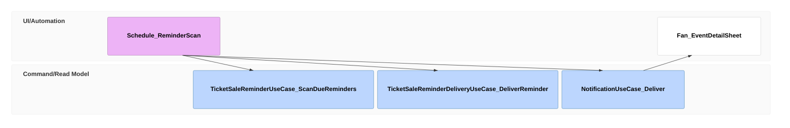

# Get reminded of ticket sale milestones

## Purpose

A fan tracking a tour is reminded of each ticket sale: 30 minutes before a first-come sale opens, and when a lottery opens and 24 hours before it closes. Each milestone is reminded once, and never between 22:00 and 08:00 in the fan's time zone.

## Requirements

### Requirement: Each milestone is reminded once

A reminder already delivered SHALL NOT be pushed again on a later scan. A fan with no registered browser SHALL receive nothing, and the reminder SHALL NOT be attempted again.

#### Scenario: Next scan

- **WHEN** the Ticket Sales Open reminder was delivered and the scan runs again 15 minutes later
- **THEN** the fan receives no second Ticket Sales Open push for that presale

#### Scenario: No registered browser

- **WHEN** a tracking fan has no registered browser when a presale opens
- **THEN** nothing is pushed and the reminder is not attempted again when the fan registers a browser later

### Requirement: No reminder at night, and first-come reminders come earlier

A milestone that falls between 22:00 and 08:00 in the fan's time zone SHALL be reminded at 08:00. The exception is a first-come sale's reminder, which SHALL arrive at 21:00 the evening before, so it still comes before the sale opens.

#### Scenario: Lottery opening at 02:00

- **WHEN** a tracked lottery opens at 02:00 in the fan's time zone
- **THEN** the fan's 抽選受付スタート push arrives at about 08:00

#### Scenario: First-come sale at midnight

- **WHEN** a tracked first-come sale opens at 00:00 in the fan's time zone
- **THEN** the fan's まもなく先着販売開始 push arrives at about 21:00 the evening before

### Requirement: The Organizer's own sales are reminded too

A fan tracking an event of an Organizer's Published Series SHALL receive the same milestone reminders for each of the Organizer's TicketSales that offers that event as for discovered sales, and none for a sale that does not offer an event the fan tracks. Tapping such a reminder SHALL open the detail sheet of the fan's earliest upcoming tracked event that the sale offers. A fan SHALL receive no reminder for a sale of a Series that is Cancelled.

#### Scenario: Organizer's lottery reminders
- **WHEN** a fan tracks an event of an Organizer's Published Series whose lottery opens on 5 October 18:00 and closes on 12 October 23:59
- **THEN** the fan receives one 抽選受付スタート push around 5 October 18:00 and one 抽選締切が近づいています push around 08:00 on 12 October

#### Scenario: Organizer's first-come sale
- **WHEN** a fan tracks an event of an Organizer's Published Series whose first-come sale opens on 6 October 19:00
- **THEN** by 18:45 on 6 October the fan's browser receives one まもなく先着販売開始 push

#### Scenario: Sale for another event of the tour
- **WHEN** a fan tracks only the Osaka event of an Organizer's tour and the Organizer's lottery offers only the Tokyo event
- **THEN** the fan receives no reminder for that lottery

#### Scenario: Series cancelled before the sale opens
- **WHEN** an Organizer cancels the Series the day before its lottery opens
- **THEN** the tracking fan receives no reminder for that lottery

### Requirement: Milestone reminders reach tracking fans

For each known TicketSale of a series, discovered or the Organizer's own, TicketSaleReminderUseCase.ScanDueReminders SHALL find the milestones that have become due for each fan in the milestone's audience, and TicketSaleReminderDeliveryUseCase.DeliverReminder SHALL deliver each of them. The fan SHALL receive one push per milestone on each registered browser within 15 minutes of the milestone, outside the fan's quiet hours, and SHALL have one sales reminder Notification recorded for it. The milestones and their audiences are:

- for a first-come sale: 30 minutes before it opens, to each fan whose journey on an event of the series is Tracking
- for a lottery: when it opens and 24 hours before it closes, to each fan whose journey on an event of the series is Tracking

Tapping a reminder SHALL open the detail sheet of the fan's earliest upcoming event of the series in that audience.

#### Scenario: First-come sale about to open
- **WHEN** a tracked tour's first-come sale opens at 19:00 in the fan's time zone
- **THEN** by 18:45 the fan's browser receives one push titled with the artist and まもなく先着販売開始, naming the opening time and the tour

#### Scenario: Lottery reminders
- **WHEN** a tracked tour's discovered lottery opens on 5 October 18:00 and closes on 22 October 23:59
- **THEN** the fan receives one push around 5 October 18:00 and one around 08:00 on 22 October

#### Scenario: Fan who has applied
- **WHEN** a fan sets their journey on the tour's event to Applied more than 24 hours before the lottery closes, and the lottery's page states that results are announced on 3 November 15:00
- **THEN** the fan receives no closing reminder for it and no push on 3 November
