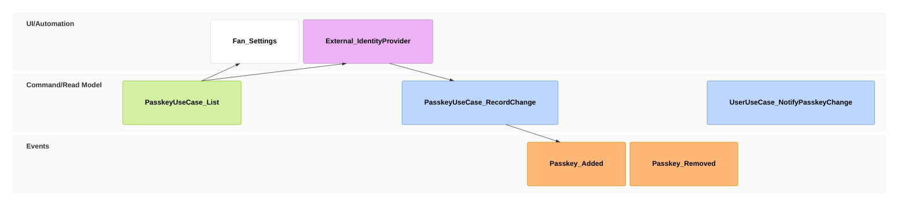

# stories/manage-passkeys Specification

## Purpose
A signed-in fan keeps their passkeys in order: adds one on another device so it can sign in there, sees which passkeys their account has, removes ones they no longer use or do not recognize, and is told by email about every change.

## Requirements

### Requirement: A fan adds a passkey on another device

A fan who signs in on a device whose passkey provider does not hold one of their passkeys (for example, a Windows laptop signed in with the phone's passkey by scanning a QR code) SHALL be able to open passkey management in Settings and add a passkey on that device, after which the device signs in with its own passkey. The fan SHALL receive the email that a passkey was added.

#### Scenario: Phone to laptop

- **WHEN** a fan signs in on a laptop with their phone's passkey, opens passkey management within 5 minutes and adds a passkey on the laptop
- **THEN** the next sign-in on the laptop uses the laptop's passkey, and the fan receives the passkey-added email

### Requirement: A fan removes a passkey they no longer trust

A fan SHALL be able to remove any passkey but the last from passkey management; the removed passkey SHALL no longer sign in to the account, and the fan SHALL receive the email that a passkey was removed. The passkey-added email SHALL tell a fan who did not add the passkey to remove it in passkey management.

#### Scenario: Unrecognized passkey

- **WHEN** a fan receives a passkey-added email they did not cause, opens passkey management and removes the unknown passkey
- **THEN** that passkey can no longer sign in to the account, and the fan receives the passkey-removed email

#### Scenario: Only one passkey

- **WHEN** a fan with one passkey opens passkey management
- **THEN** that passkey cannot be removed until another passkey is added
