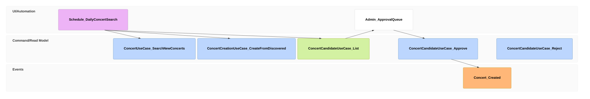

# Review concert candidates

## Purpose

An admin reviews concerts held back from automatic publishing, publishing the good ones, reconciling duplicates, and dropping the wrong ones, while rejected concerts stay eligible for later discovery.

## Requirements

### Requirement: Concert candidates are reviewed through the queue

A concert staged by ConcertCreationUseCase.CreateFromDiscovered SHALL appear in ConcertCandidateUseCase.List until ConcertCandidateUseCase.Approve or ConcertCandidateUseCase.Reject removes it, and SHALL appear in no fan-facing list meanwhile.

#### Scenario: Approve publishes
- **WHEN** an admin approves a ConcertCandidate with no collision
- **THEN** it leaves the queue and is a Concert in the catalog under its Series

#### Scenario: Duplicate reconciled
- **WHEN** an admin approves a colliding ConcertCandidate, sees the conflict, and approves again choosing keep existing
- **THEN** it leaves the queue, the existing Concert is unchanged, and a RejectedConcert entry records it

### Requirement: Rejection is not permanent

A concert rejected with ConcertCandidateUseCase.Reject SHALL, when discovered again, be handled like any new discovery by ConcertCreationUseCase.CreateFromDiscovered.

#### Scenario: Rejected concert found again
- **WHEN** a rejected concert is found again at a resolvable venue with a free slot
- **THEN** it is published as a Concert
