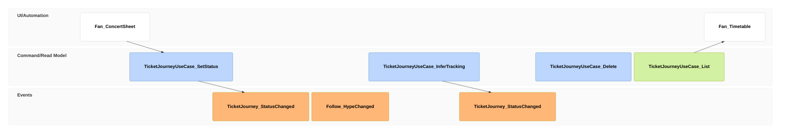

# Track ticket journey

## Purpose

A fan records where they stand in getting a ticket for an event, or the app records it from the fan's own actions, and sees the same status for that event on every screen, right after the change is saved and never from someone else's session.

## Requirements

### Requirement: One status per event on every screen

A fan's ticket journey status for an event SHALL be the same on the Timetable and in the concert sheet. A status the fan sets or removes in the concert sheet SHALL appear on the Timetable as soon as the server accepts it, without the fan reloading or leaving the Timetable.

#### Scenario: Setting a status in the detail sheet updates the Timetable

- **WHEN** a signed-in fan sets Applied for an event in the concert sheet and the change is saved
- **THEN** the concert sheet and the Timetable's card for that event both show Applied, without the fan leaving or reloading the Timetable

#### Scenario: Removing a status in the detail sheet updates the Timetable

- **WHEN** a signed-in fan removes their journey for an event in the concert sheet and the removal is saved
- **THEN** neither the concert sheet nor the Timetable shows a status for that event

#### Scenario: Both screens agree

- **WHEN** the Timetable and the concert sheet both show the same event
- **THEN** they show the same journey status for it

### Requirement: A status is shown only after the server accepts it

A status change SHALL appear on the fan's screens only after the server has saved it. When saving fails, every screen SHALL keep showing the status the fan had before.

#### Scenario: Saving fails

- **WHEN** a signed-in fan picks Paid for an event whose status is Unpaid and saving fails
- **THEN** the Timetable and the concert sheet still show Unpaid

### Requirement: Statuses are loaded fresh and never overwrite a newer change

Each time the Timetable loads its concerts for a signed-in fan, it SHALL show the fan's latest journey statuses from the server. A status the fan saved while that load was still running SHALL NOT be replaced by the older loaded status.

#### Scenario: Opening the Timetable shows the latest statuses

- **WHEN** a signed-in fan changed a journey status on another device and then opens the Timetable
- **THEN** the Timetable shows the status saved on the other device

#### Scenario: A change saved during a load wins

- **WHEN** the Timetable is loading statuses and the fan saves Unpaid for an event before the load finishes
- **THEN** the event keeps showing Unpaid after the load finishes

### Requirement: Guests and signed-out fans see no statuses

A guest SHALL have no ticket journey statuses, and the app SHALL not ask the server for any. A guest's concert sheet SHALL offer only the ticket sale notification button, which offers sign-up in a dialog that says notifications need an account. After a fan signs out, no screen SHALL show that fan's statuses.

#### Scenario: A guest opens the Timetable

- **WHEN** a guest opens the Timetable
- **THEN** no concert shows a journey status and no journeys are requested from the server

#### Scenario: A guest opens a concert

- **WHEN** a guest opens a concert's detail sheet
- **THEN** the sheet offers 「🔔 チケット販売の通知を受け取る」 and no other status

#### Scenario: Signing out clears the statuses

- **WHEN** a fan with journey statuses signs out and the next visitor opens the Timetable in the same browser
- **THEN** none of the previous fan's statuses are shown

### Requirement: Adding a concert to the calendar starts tracking it

When a signed-in fan with no journey for an event adds its concert to their calendar from the concert sheet, TicketJourneyUseCase.InferTracking SHALL record Tracking for the event as an inference, every screen SHALL show Tracking for it, and the fan SHALL be able to undo it from the snack shown when they come back to the app. A journey the fan or the platform already recorded SHALL never be changed by a calendar add. A calendar add SHALL be the only action the app records Tracking from; opening a notification or a detail sheet SHALL record no journey.

#### Scenario: Calendar add starts tracking and the fan hears about the sale

- **WHEN** a signed-in fan with no journey for an event adds it to their calendar, and later a ticket sale for the event's series is found that has not opened
- **THEN** the fan's journey for the event is Tracking, and the fan is told about the sale as for any Tracking journey

#### Scenario: Undo removes the inferred journey

- **WHEN** the fan presses 「取り消す」 on the snack after coming back from the calendar
- **THEN** the event has no journey on any screen

#### Scenario: Existing journey kept

- **WHEN** a fan whose journey for the event is Paid adds it to their calendar
- **THEN** the journey stays Paid

#### Scenario: Opening a new-concert push changes no journey

- **WHEN** the fan opens a new-concert push notification and the detail sheet of the earliest concert opens
- **THEN** no journey is recorded for any concert in the notification

### Requirement: A journey for a distant concert raises the artist's hype level

When a signed-in fan saves Applied, Unpaid or Paid for a concert in the concert sheet, and the fan follows exactly one of its artists at a hype level the fan did not set that does not match the concert, TicketJourneyUseCase.SetStatus SHALL raise that hype level to the lowest level that matches the concert. A concert whose distance from the fan's home cannot be measured has no lowest matching level (components/entity/follow), so it raises nothing. My Artists and the Timetable SHALL show the new level, and the sheet SHALL offer to undo it.

#### Scenario: Applied for a distant concert

- **WHEN** a signed-in fan with home JP-13 who never set ヨルシカ's hype level saves Applied for ヨルシカ's concert in JP-40
- **THEN** My Artists shows ヨルシカ at Away and the JP-40 concert is highlighted on the Timetable

### Requirement: A guest's request for ticket sale notifications survives sign-up

When a guest presses the ticket sale notification button on a concert's detail sheet, chooses Sign Up in the dialog that opens, signs up and the account is resolved, the app SHALL set Tracking for that event through TicketJourneyUseCase.SetStatus, as the fan's own choice, and SHALL open that concert's detail sheet. The Timetable SHALL then show the event with the Tracking badge, and the fan SHALL receive the ticket sale reminders of the series like any tracking fan. When the guest leaves sign-up without finishing it, nothing SHALL be set, and a later sign-up started elsewhere SHALL NOT track the event.

#### Scenario: Guest signs up from the notification button

- **WHEN** a guest presses 「🔔 チケット販売の通知を受け取る」 on ヨルシカ's 20 December concert, chooses 「Sign Up」 and completes sign-up
- **THEN** the fan's journey for that event is Tracking, the concert's detail sheet is open, and its card on the Timetable shows 🔔

#### Scenario: Sign-up abandoned

- **WHEN** a guest presses the button, chooses 「Sign Up」, leaves hosted login without signing up, and later signs up from the Timetable banner
- **THEN** the fan has no journey for that event

#### Scenario: Guest chooses later
- **WHEN** a guest presses the button and chooses 「あとで」
- **THEN** no sign-up starts and, after a later sign-up from the Timetable banner, the fan has no journey for that event
