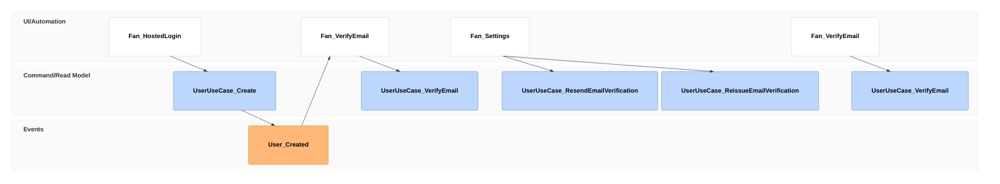

# stories/verify-email-address Specification

## Purpose
A fan who signs up verifies their email address from the verification email, in their own language, and comes back to the app, so the address can later receive a passkey recovery link.

## Requirements

### Requirement: A fan verifies their address from the email

After sign-up, a fan SHALL receive a verification email in their preferred language. Opening its link on any device and confirming SHALL verify the address without signing in, and SHALL offer a way into the app. Settings SHALL then show the address as verified on the fan's signed-in devices the next time Settings is opened or its tab is shown.

#### Scenario: Sign up, then verify on the phone

- **WHEN** a fan signs up in Japanese, opens the verification email on their phone and taps "メールアドレスを確認する"
- **THEN** the email was in Japanese, the screen says the address is verified, and Settings on their laptop shows 確認済み when they return to it

### Requirement: An expired link leads to a fresh email

A fan whose link has expired or was used SHALL be told so and SHALL be able to get a new verification email from Settings, whose link then verifies the address.

#### Scenario: Link expired

- **WHEN** a fan opens a verification link after more than 1 hour, then requests a new email from Settings and confirms with its link
- **THEN** the first link is refused as expired and the second verifies the address
