# Win Tickets In A Lottery

## Purpose

A fan authorizes their card for a number of tickets and confirms the entry, the draw runs after the window closes, and a winning fan is charged and receives account-bound covered tickets while a losing fan is never charged; every fan is told the result.

```mermaid
eventmodeling
tf 01 ui Member_Event
tf 02 cmd SeatTypeUseCase_Create
rf 03 cmd TicketStockUseCase_Create ->> 01
rf 04 ui Member_TicketSaleEditor
tf 05 cmd TicketSaleUseCase_Create
rf 06 ui Fan_LotteryEntry
tf 07 cmd LotteryEntryUseCase_AuthorizeCard
rf 08 pcr External_PaymentProvider
rf 09 cmd LotteryEntryUseCase_Confirm ->> 06 ->> 08
tf 10 evt LotteryEntry_Entered
tf 11 cmd TicketJourneyUseCase_MarkApplied
rf 12 pcr Schedule_DrawWindowClosed
tf 13 cmd LotteryEntryUseCase_DrawDueSales
tf 14 cmd LotteryEntryUseCase_Draw
tf 15 evt LotteryEntry_Drawn
tf 16 cmd OrderUseCase_Issue
tf 17 evt Order_Paid
tf 18 cmd TicketJourneyUseCase_MarkPaid
rf 19 cmd NotificationUseCase_SendOrderConfirmation ->> 17
rf 20 ui Member_Concert
tf 21 cmd SeriesUseCase_Cancel
tf 22 evt Event_Cancelled
tf 23 cmd LotteryEntryUseCase_EndForCancelledEvent
tf 24 evt LotteryEntry_Drawn
rf 25 cmd OrderUseCase_ReleaseCardAuthorization ->> 15 ->> 24
rf 26 cmd NotificationUseCase_SendLotteryLoss ->> 15 ->> 24
rf 27 rmo LotteryEntryUseCase_ListByTicketSale ->> 15 ->> 24
tf 28 ui Fan_LotteryEntry
rf 29 rmo TicketUseCase_List ->> 17
tf 30 ui Fan_Tickets
rf 31 pcr Schedule_SettlementDue
tf 32 cmd SettlementUseCase_ReleaseDueSettlements
```

## Requirements

### Requirement: The Organizer's payout readiness never blocks the sale

Fans SHALL be able to enter, win and receive tickets for an Organizer's lottery whatever the state of the Organizer's payout account; only the Organizer's payout waits until the account is Active, as SettlementUseCase.ReleaseDueSettlements states.

#### Scenario: Organizer still in identity check
- **WHEN** an Organizer whose payout account is Pending runs a lottery and a fan's entry wins
- **THEN** the fan is charged and holds Issued Tickets, while the Organizer's payout stays Held until the account is Active

### Requirement: A winning fan receives tickets

After an Organizer stocks a SeatType for a published event with TicketStockUseCase.Create and creates a Lottery TicketSale naming the event with TicketSaleUseCase.Create, a fan SHALL be able to authorize their card for a ticket count of that TicketStock with LotteryEntryUseCase.AuthorizeCard, complete card authentication and confirm the entry with LotteryEntryUseCase.Confirm while the window is open. After the window closes, the platform SHALL draw the sale and tell each fan the result. When the fan's entry wins, the fan SHALL be charged, receive the confirmation email and a push notification saying the entry won, find the entry Won with LotteryEntryUseCase.ListByTicketSale and find its Tickets with TicketUseCase.List.

#### Scenario: Demand within quantity
- **WHEN** a fan enters 2 tickets for a TicketStock of 100 tickets whose SeatType is priced 8000 yen, and the window closes with fewer than 100 tickets requested
- **THEN** after the draw the fan's entry is Won, 16000 yen is charged, the fan receives one confirmation email saying the entry won, and the fan holds 2 Issued Tickets for the event, their faces show the fan's full name and phone number, and their ticket journey for the event is Paid

### Requirement: A losing fan is never charged

A fan whose entry is not admitted SHALL be told by email and push notification that the entry lost, SHALL find it Lost with LotteryEntryUseCase.ListByTicketSale and SHALL NOT be charged.

#### Scenario: Oversubscribed sale
- **WHEN** a TicketStock with 4 tickets remaining closes with entries for 12 tickets and the fan's entry is not admitted
- **THEN** the fan's entry is Lost, its card authorization is released, the fan receives one email saying the entry lost and nothing is charged, and the fan holds no Ticket for the event

### Requirement: A presale and a general sale share the per-account limit

When an event has a presale and a later general sale, a fan who won tickets in the presale SHALL be able to enter the general sale only for the tickets still under the event's per-account limit.

#### Scenario: Presale winner at the limit
- **WHEN** a fan won 4 tickets in an event's presale and the event's per-account limit is 4
- **THEN** the fan's entry into the general sale is refused and the fan still holds 4 Tickets

#### Scenario: Presale winner below the limit
- **WHEN** a fan won 2 S席 tickets in the presale and enters 2 S席 tickets in the general sale of an event with a per-account limit of 4
- **THEN** the entry is made

### Requirement: An entry is made once the card is authenticated

A fan SHALL have an entry only after completing card authentication for it, and SHALL have it then even if the browser closes before the fan's confirmation reaches the platform. A card authorization for a count the fan left before authenticating SHALL hold nothing and make no entry. Only an entry made before the window closes takes part: an authentication whose entry would be made after the end time SHALL be released instead.

#### Scenario: Count changed before confirming
- **WHEN** a fan authorizes their card for 2 tickets, goes back, authorizes it for 3 tickets, completes card authentication and confirms
- **THEN** the fan has one Entered entry, for 3 tickets, and nothing is held on the card for 2 tickets

#### Scenario: Browser closed after card authentication
- **WHEN** a fan completes card authentication and the browser closes before the confirmation reaches the platform
- **THEN** the fan's entry is Entered and takes part in the draw

#### Scenario: Entry made only after the window closed
- **WHEN** a fan completes card authentication 10 seconds before the end time, and neither the fan's confirmation nor the payment provider's notice reaches the platform before the end time
- **THEN** the fan has no entry, the card authorization is released and the fan is never charged

#### Scenario: Card authentication abandoned
- **WHEN** a fan authorizes their card but leaves without completing card authentication, and the window closes
- **THEN** the fan has no entry and is never charged

### Requirement: One seat type per account and event

A fan SHALL hold or apply for tickets of only one SeatType for an event, across every sale of the event, and SHALL enter one Lottery sale at most once for each event.

#### Scenario: Presale winner picks another seat type
- **WHEN** a fan won 2 S席 tickets in an event's presale and enters A席 in the general sale
- **THEN** the entry is refused and the fan still holds 2 S席 Tickets

#### Scenario: Second entry into the same sale
- **WHEN** a fan entered a lottery sale for S席 and tries to enter the same sale again
- **THEN** the second entry is refused

### Requirement: A draw that stops midway keeps its winners

When the platform stops while it draws a sale or charges its winners, the draw SHALL resume with the same winners: every Won fan SHALL be charged once and receive their Tickets, and no fan SHALL be charged without Tickets.

#### Scenario: Stopped after the first charge
- **WHEN** a sale's TicketStock with 4 tickets remaining closes with entries for 2, 2 and 3 tickets, the platform stops after charging one of the two winners, and starts again
- **THEN** the same two entries are Won, each winner is charged once and holds 2 Issued Tickets, and the 3-ticket entry is Lost and never charged

### Requirement: A winner whose card can no longer be charged loses

When a Won fan's card authorization can no longer be charged, the fan's entry SHALL become Lost, the fan SHALL be told by email that the win was cancelled because the card could not be charged, and the fan SHALL NOT be charged or hold any Ticket for it. Its tickets stay unallocated.

#### Scenario: Card closed before the charge
- **WHEN** a fan's entry wins and the fan's card was closed before the charge
- **THEN** the fan's entry is Lost, nothing is charged, the fan holds no Ticket for the event, and the fan receives one email saying the win was cancelled because the card could not be charged

### Requirement: An entry marks the fan's journey Applied

When a fan's lottery entry is made, TicketJourneyUseCase.MarkApplied SHALL record the fan's ticket journey for the event as Applied, set by the platform, after the entry is announced, so the Dashboard and the event detail sheet show Applied without the fan setting it. Recording the journey SHALL never fail or delay the entry. A winning fan's journey then becomes Paid as the purchase is recorded.

#### Scenario: Entry made

- **WHEN** a fan with no journey for the event confirms their entry
- **THEN** the Dashboard and the event detail sheet show Applied for the event

#### Scenario: Entry wins

- **WHEN** the fan's entry wins and the purchase is recorded
- **THEN** the fan's journey for the event is Paid

### Requirement: A cancelled concert charges no lottery fan

When a member cancels (中止) an Event, no further charge SHALL be made for its lottery and no fan who has not been charged SHALL receive Tickets for it. Each Entered entry of the Event SHALL become Lost, its card authorization SHALL be released and its fan SHALL be told by email and push that the concert is cancelled and that nothing is charged, without waiting for the sale's window to close. A Won entry whose charge is still to be attempted SHALL end the same way at that attempt. A charge that had already gone through SHALL NOT be undone by ending the entry: its Order becomes Paid and is refunded with the Event's other Paid Orders. No new entry for the Event SHALL be accepted. The other dates of the same sale SHALL carry on.

#### Scenario: Cancelled during the window
- **WHEN** a member cancels an Event whose lottery window is open, with two fans Entered
- **THEN** both entries are Lost, both card authorizations are released, each fan receives one email and push saying the concert is cancelled and nothing is charged, and when the window closes nobody is charged and no Ticket is issued

#### Scenario: Cancelled between the draw and the charge
- **WHEN** a draw records a fan's entry Won and the member cancels the Event before the charge
- **THEN** nothing is charged, the entry is Lost, its card authorization is released and the fan is told the concert is cancelled

#### Scenario: Entering after the cancellation
- **WHEN** a fan with the entry screen still open tries to enter after the Event was cancelled
- **THEN** the entry is refused, no entry is made and nothing stays held on the card

#### Scenario: Another date of the sale
- **WHEN** a sale names two Events, and a member cancels one while fans are Entered for both
- **THEN** the entries of the cancelled Event are Lost, and the entries of the other Event stay Entered and are drawn when the window closes
